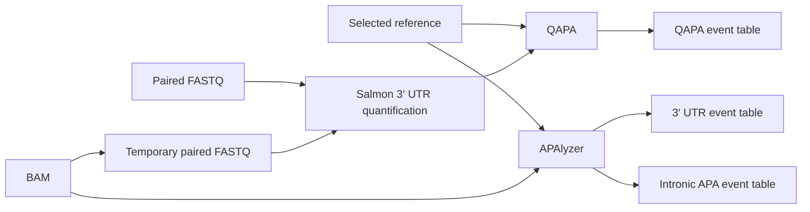

# APA pipeline

This Snakemake pipeline quantifies alternative polyadenylation events with QAPA
and APAlyzer. It does not test for group differences or create analysis-ready
summary matrices.

## Workflow



QAPA uses paired FASTQ files. In BAM mode, the pipeline makes temporary FASTQ
files and removes them after Salmon finishes. APAlyzer reads BAM files directly.

## Outputs

```text
{output_dir}/
├── {sample}/{reference_name}/qapa_salmon/quant.sf
├── {sample}/{apalyzer_reference_name}/apalyzer/3utr.tsv
├── {sample}/{apalyzer_reference_name}/apalyzer/ipa.tsv
└── events/
    ├── {cohort}_{reference_name}_qapa_events.tsv
    ├── {cohort}_{apalyzer_reference_name}_apalyzer_3utr_events.tsv
    └── {cohort}_{apalyzer_reference_name}_apalyzer_ipa_events.tsv
```

`apalyzer_reference_name` defaults to `reference_name`. Event tables carry the
reference name, so runs on different references coexist.

The QAPA cohort table is the direct output of `qapa quant`. It contains event
annotation, PAU, and TPM columns for every sample.

The APAlyzer cohort tables are stacked copies of the per-sample results. Sample
prefixes are removed from metric names and the sample ID is stored in a
`sample` column. The tables keep APAlyzer's counts, normalized values, and
relative expression values.

| File | Main fields |
|---|---|
| QAPA events | Event ID, transcript, gene, coordinates, UTR length, sample PAU, sample TPM |
| APAlyzer 3′ UTR events | Gene, aUTR reads/RPKM, cUTR reads/RPKM, `3UTR_RE`, sample |
| APAlyzer IPA events | Gene, IPA/PAS ID, upstream/downstream/last-exon reads and RPK, `IPA_RE`, sample |

The pipeline does not create:

- differential APA results
- wide RED or IPA matrices
- separate PAU and TPM matrices
- weighted 3′ UTR length estimates

## References

Set `reference_name` to one entry under `references` in `config.yaml`.

```yaml
reference_name: hg38
references:
  hg38:
    qapa:
      salmon_index: /path/to/qapa/hg38/salmon_index
      identifiers: /path/to/qapa/hg38/ensembl_identifiers.tsv
    apalyzer:
      rdata: /path/to/apalyzer/hg38_REF.RData
```

The selected files must match the genome assembly used to align the reads.

### APAlyzer

APAlyzer counts against three objects (`UTRdbraw`, `dfIPA`, `dfLE`) that the
pipeline rule `prepare_apalyzer_reference` builds once from either source:

```yaml
    apalyzer:
      rdata: /path/to/hg38_REF.RData   # official reference (PolyA_DB v3 sites)
      # or
      gtf: /path/to/annotation.pas2gef.gtf.gz   # PAS2GEF: annotated 3′ ends as sites
```

Official references exist for `hg19`, `hg38`, `mm9`, and `mm10`
([PAS_reference_RData](https://github.com/RJWANGbioinfo/PAS_reference_RData)).
For a GTF, first run `scripts/prepare_apalyzer_gtf.sh`, which converts a
GENCODE-style GTF to the Ensembl conventions `PAS2GEF()` assumes (no `chr`
prefix, `gene_name` on every record):

```bash
bash scripts/prepare_apalyzer_gtf.sh annotation.gtf annotation.pas2gef.gtf.gz
```

Two references are prepared: `hg38` from the official file (default, via
`apalyzer_reference_name`) and `isomiga` from the isoMiGA GTF. On this cohort
the PolyA_DB sites give ~30% more genes with a finite 3′ UTR RE than annotated
transcript ends do, and APAlyzer's gene-level output does not need isoform
consistency with the transcript-level data. The exact commands, results, and
the comparison are in `references/README.md`.

- [APAlyzer vignette](https://bioconductor.posit.co/packages/3.20/bioc/vignettes/APAlyzer/inst/doc/APAlyzer.html)

### QAPA

QAPA needs a 3′ UTR library (BED), a Salmon index over its sequences, and an
identifier table (`Gene stable ID`, `Transcript stable ID`, `Gene type`,
`Transcript type`, `Gene name`). Three scripts prepare them; the final step is
the same whether the library is precompiled or built here.

```bash
# Identifier table from the GTF that defines the library
bash scripts/qapa_identifiers_from_gtf.sh annotation.gtf > ensembl_identifiers.tsv

# Optional: build a library from that GTF (qapa build with GENCODE poly(A)
# track and PolyASite 2.0 filtering)
bash scripts/build_qapa_utr_library.sh annotation.gtf ensembl_identifiers.tsv \
  references/wgEncodeGencodePolyaV38.txt.gz \
  references/atlas.clusters.2.0.GRCh38.96.bed.gz qapa_3utrs.bed

# Sequences and Salmon index; stages the BED and identifier table alongside
bash scripts/prepare_qapa_reference.sh qapa_3utrs.bed ensembl_identifiers.tsv \
  GRCh38.primary_assembly.genome.fa \
  /sc/arion/projects/pd-omics/Mega_MyND/references/apa/<reference_name>/qapa
```

Two libraries are prepared under `Mega_MyND/references/apa/`:

| `reference_name` | Library | Use |
|---|---|---|
| `isomiga` | Built from `isomiga_gencode.gtf` (GENCODE v38 + microglia PacBio transcripts) | Default. Event IDs match the cohort's transcript-level quantification; includes 3′ ends supported only by long reads. |
| `hg38` | QAPA's precompiled GENCODE V31 library (`references/qapa_3utrs.gencode_V31.hg38.bed.gz`) with identifiers from the GENCODE v31 GTF | Comparison with published QAPA analyses. |

`qapa build` keeps only transcripts whose gene and transcript types are both
`protein_coding`. PacBio transcripts have no type attributes, so
`qapa_identifiers_from_gtf.sh` assigns gene type and name from the parent gene
record and transcript type `protein_coding` when a CDS is annotated. Poly(A)
inputs are the UCSC `wgEncodeGencodePolyaV38` dump and the PolyASite 2.0
GRCh38.96 atlas, both kept under `references/`. The exact commands, inputs,
checksums, and results of the two builds are in `references/README.md`. See
the [QAPA documentation](https://github.com/morrislab/qapa) before preparing a
new reference.

## Configuration

`config.yaml` is the main template. Important settings are:

| Setting | Meaning |
|---|---|
| `input_dir` | Base directory for relative input paths |
| `metadata` | Tab-separated sample sheet |
| `qapa_input` | `bam` or `fastq` |
| `output_dir` | Pipeline results |
| `reference_dir` | Prepared APAlyzer reference (`apalyzer/<reference_name>/`) |
| `reference_name` | Entry selected from `references` (QAPA, and APAlyzer unless overridden) |
| `apalyzer_reference_name` | Optional entry selected from `references` for APAlyzer only |
| `salmon_library_type` | Salmon library type |
| `apalyzer_strand_type` | `forward`, `invert`, or `NONE` |
| `apalyzer_seq_type` | `SingleEnd` or `ThreeMostPairEnd` |

Input paths may be absolute or relative to `input_dir`. Sample IDs must be
unique and may contain letters, numbers, dots, underscores, and hyphens.

Required sample-sheet columns:

```text
sample    BAM
```

This is enough for APAlyzer and for QAPA in BAM mode. QAPA FASTQ mode uses:

```text
sample    R1    R2
```

One sheet may contain all four columns.

## Run

The driver submits jobs through LSF and requires Snakemake 7.

```bash
cd /sc/arion/projects/pd-omics/alex/pipelines/apa-pipeline
bash submit.sh
```

Useful options:

```bash
# Check the workflow without submitting jobs
DRYRUN=1 CONFIG=/path/to/config.yaml bash submit.sh

# Quantify samples only
PHASES=1 CONFIG=/path/to/config.yaml bash submit.sh

# Build cohort event tables from completed sample output
PHASES=2 CONFIG=/path/to/config.yaml bash submit.sh
```

| Variable | Default | Meaning |
|---|---|---|
| `CONFIG` | `config.yaml` | Configuration file |
| `SNAKEMAKE_ENV` | Lab Snakemake 7 environment | Snakemake environment |
| `JOBS` | `50` | Maximum active jobs |
| `PHASES` | `1 2` | Phases to run |
| `DRYRUN` | `0` | Set to `1` for a dry run |

## Software

The current cluster setup uses Snakemake 7.32.4, Salmon 1.9.0, QAPA 1.4.1,
APAlyzer 1.20.0 with R 4.4.1, and Samtools 1.17.

## Files

```text
Snakefile                              workflow rules
cluster.yaml                           LSF resources
config.yaml                            configuration template
example/config.yaml                    two-sample dry-run template
submit.sh                              workflow driver
scripts/qapa_identifiers_from_gtf.sh   QAPA identifier table from a GTF
scripts/build_qapa_utr_library.sh      QAPA 3' UTR library from a GTF (qapa build)
scripts/prepare_qapa_reference.sh      QAPA sequences and Salmon index
scripts/prepare_apalyzer_gtf.sh        GTF preparation for PAS2GEF
scripts/prepare_apalyzer_reference.R   APAlyzer reference (RData or GTF source)
scripts/run_apalyzer.R                 per-sample APAlyzer counting
scripts/collect_apalyzer_events.R      event-table collection
```
